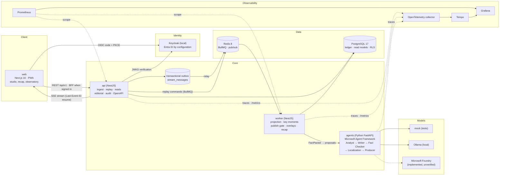

# MatchIQ

[](https://github.com/WapSecure/matchiq/actions/workflows/ci.yml)

**Evidence-grounded football intelligence for broadcast and streaming.** MatchIQ ingests synthetic football events and computes match state with a deterministic engine. It detects key moments that can be explained, and a team of specialised AI agents (Microsoft Agent Framework) turns each moment into narratives for three audiences and four languages, plus a timed broadcast overlay. No number is invented: every statistic comes from the engine, every claim cites its source events, and a deterministic publish gate checks every agent draft before anything goes on air. Producers keep control with freeze, retract, suppress and an organisation-wide kill switch, and every action is audited.

Built for the **Microsoft × Premier League: Inside the Game** developer hackathon, and designed to be a credible enterprise product beyond it.

> **Synthetic data only.** All clubs, players and events are fictional and generated by `libs/synthetic-data`. MatchIQ is not affiliated with, licensed by or endorsed by the Premier League, and it uses no Premier League marks, footage or data.

| Submission material                                  | Where                                                                                                                                                                                                         |
| ---------------------------------------------------- | ------------------------------------------------------------------------------------------------------------------------------------------------------------------------------------------------------------- |
| Write-up                                             | [`docs/submission/SUBMISSION.md`](docs/submission/SUBMISSION.md)                                                                                                                                              |
| Judging criteria and evidence                        | [`docs/submission/JUDGING_MAP.md`](docs/submission/JUDGING_MAP.md)                                                                                                                                            |
| Demo video script                                    | [`docs/submission/DEMO_SCRIPT.md`](docs/submission/DEMO_SCRIPT.md)                                                                                                                                            |
| Pitch deck (Slides, downloadable .pptx/PDF); outline | [`docs/submission/PITCH_DECK.md`](docs/submission/PITCH_DECK.md)                                                                                                                                              |
| Requirements traceability                            | [`docs/requirements-traceability.csv`](docs/requirements-traceability.csv)                                                                                                                                    |
| Submission checklist                                 | [`docs/submission/CHECKLIST.md`](docs/submission/CHECKLIST.md)                                                                                                                                                |
| Enterprise audit and traceability matrix             | [`docs/audits/`](docs/audits/MATCHIQ_ENTERPRISE_IMPLEMENTATION_AUDIT.md) ([matrix](docs/audits/MATCHIQ_REQUIREMENTS_TRACEABILITY_MATRIX.md), [CSV](docs/audits/MATCHIQ_REQUIREMENTS_TRACEABILITY_MATRIX.csv)) |
| Progress, with evidence                              | [`docs/implementation-log.md`](docs/implementation-log.md)                                                                                                                                                    |
| Hosted demo                                          | **None.** The owner decided not to host before the verdict; the local setup below is the test build ([`HOSTING_OPTIONS.md`](docs/deployment/HOSTING_OPTIONS.md) records the deferred option).                 |

## Run it in 5 minutes

The five minutes assume Docker, Node 22 and pnpm 10 are installed and dependencies are already downloaded. A first run spends longer on `pnpm install` or on building images.

### Option A: everything in containers (public demo, no sign-in)

```bash
git clone https://github.com/WapSecure/matchiq.git && cd matchiq
docker compose --profile app up -d --build --wait
```

This starts Postgres, Redis, a one-shot `migrate` job that also seeds the six golden fixtures, then the api (`:3000`), worker (`:3001`), agents (`:8000`) and web (`:4200`). Open <http://localhost:4200>, choose **Fixtures**, then **Start** on _Late comeback_.

Verify the running stack, seeded fixture and replay path with:

```bash
bash scripts/compose-smoke.sh
```

In this profile the agents container runs `MODEL_PROVIDER=mock` and `AI_ENABLED` defaults to `false`, so the narratives on screen are deterministic templates, labelled as such. Sign-in is not available in the web container ([why](docs/security/IDENTITY_AND_ACCESS.md#web-sign-in)). Details: [`docs/deployment/LOCAL_STACK.md`](docs/deployment/LOCAL_STACK.md). CI starts the same profile from an empty runner and runs the smoke check on every pull request and protected-branch push.

### Option B: native services (sign-in, real local AI)

Prerequisites: Node 22 (`.nvmrc`), pnpm 10, [uv](https://docs.astral.sh/uv/), Docker, and optionally [Ollama](https://ollama.com) for real inference.

```bash
pnpm install && (cd apps/agents && uv sync)
cp .env.example .env
# Fill the three secrets in .env with `openssl rand -hex 32` each:
#   STREAM_TICKET_SECRET, AGENTS_SERVICE_TOKEN, WEB_SESSION_SECRET
pnpm infra:up                  # Postgres :54320, Redis :63790, Keycloak :8180
pnpm nx run db:migrate         # apply migrations
pnpm seed:fixtures             # load the six golden fixtures (idempotent)
pnpm dev                       # api :3000, worker :3001, agents :8000, web :4200
```

Every service validates its environment at start-up and exits with a readable message if a value is missing.

**Real local AI.** Run `ollama pull qwen2.5:7b-instruct` and `ollama serve`, then set the local profile from `.env.example`:

```bash
AI_ENABLED=true
MODEL_PROVIDER=ollama
OLLAMA_MODEL=qwen2.5:7b-instruct
AGENT_TIMEOUT_MS=120000
AGENT_JOB_CONCURRENCY=1
```

Templates air at once. Agent narratives replace them as they pass the checks, roughly a minute or more per insight on a laptop (see [Providers](#ai-providers-what-is-real)).

**No model? Use a recorded run.** On a machine without Ollama or a strong GPU, replay real model wording captured earlier. Nothing is installed and no model runs:

```bash
AI_ENABLED=true
MODEL_PROVIDER=recorded
```

Start the Late comeback scenario. The template airs first, then the recorded wording arrives after about 1.5 seconds (`RECORDED_LATENCY_MS`). It goes through the same fact check and publish gate as live output, so a draft whose numbers no longer match is rejected and the template airs. The Fact-checks page labels these runs "Recorded model run". It is a replay of earlier output from a local model, not a live model, and it covers only the Late comeback scenario ([ADR-0042](docs/adr/0042-recorded-model-provider.md), [how it was recorded](apps/agents/src/matchiq_agents/providers/recordings/README.md)).

**Health checks.** `curl -s localhost:3000/api/v1/health/live` (api), `:3001` (worker), `:8000` (agents).

### Sign-in (development accounts only)

With Option B, open <http://localhost:4200/sign-in>. The local Keycloak realm has eight synthetic accounts. They all use the password `matchiq-dev-only`, which exists only in the committed local realm export and must never be used elsewhere. The sign-in page labels these accounts "Development only". The realm file is not used by any hosted environment, and a hosted deployment must use a secret manager. This is an accepted local development deviation from specification §36 ([ADR-0025](docs/adr/0025-local-development-credentials.md)).

| Account              | Organisation (synthetic) | Role         | Try                                               |
| -------------------- | ------------------------ | ------------ | ------------------------------------------------- |
| `harbour.producer`   | `org_demo`               | producer     | Freeze, retract, suppress, kill switch, audit     |
| `harbour.analyst`    | `org_demo`               | analyst      | Agent Observatory, no editorial controls          |
| `harbour.viewer`     | `org_demo`               | viewer       | Watch only; the Observatory answers 403           |
| `harbour.owner`      | `org_demo`               | tenant-owner | Audit trail                                       |
| `northbank.producer` | `org_northbank`          | producer     | Cannot see `org_demo` sessions (tenant isolation) |

The full list and the permission matrix are in [`docs/security/IDENTITY_AND_ACCESS.md`](docs/security/IDENTITY_AND_ACCESS.md). Without signing in, the app runs as the read-only public demo tenant: replay controls work and editorial controls are shown locked.

## Architecture



How an insight reaches the screen:

1. The worker replays a synthetic fixture into the session's append-only ledger (a database trigger refuses updates and deletes; only retention can purge a whole expired ledger). The pure engine (`libs/football-engine`) projects each event into a `MatchSnapshot` with a state hash ([ADR-0002](docs/adr/0002-deterministic-engine-first.md)).
2. Key-moment rules emit an `Insight` with an evidence envelope: computed metrics, source event ids and counter-evidence.
3. A deterministic template narrative and overlay go on air at once, so the product works with AI off.
4. With AI on, the worker sends a `FactPacket` to the agents service. Agent Framework executors run the roster as a typed state machine with revise and reject branches ([ADR-0011](docs/adr/0011-agent-orchestration.md)). The agents service only returns proposals.
5. The worker's publish gate checks every cited value, numeral, evidence id, entity name and length. A draft that passes replaces the template; one that fails is never shown ([ADR-0013](docs/adr/0013-replay-sessions-and-intelligence-pipeline.md)).
6. Editorial policy (freeze, kill switch, suppress, retract) applies after the scheduler, and every decision is audited ([ADR-0016](docs/adr/0016-editorial-control-and-audit.md)).
7. Everything reaches the browser through the outbox and a resumable SSE stream ([ADR-0005](docs/adr/0005-api-and-streaming-conventions.md), [ADR-0006](docs/adr/0006-persistence-and-messaging.md)).

## AI providers: what is real

The agents service picks one provider with `MODEL_PROVIDER` ([ADR-0012](docs/adr/0012-local-first-ai-providers.md)). The Agent Observatory labels every run with the provider that actually produced it.

| Provider   | What it is                                                                                                                                  | Status                                                                                                                                                                                                                                                                                                                                                                                                                                                                                                                                                                                                                                                                                                                                                                                   |
| ---------- | ------------------------------------------------------------------------------------------------------------------------------------------- | ---------------------------------------------------------------------------------------------------------------------------------------------------------------------------------------------------------------------------------------------------------------------------------------------------------------------------------------------------------------------------------------------------------------------------------------------------------------------------------------------------------------------------------------------------------------------------------------------------------------------------------------------------------------------------------------------------------------------------------------------------------------------------------------- |
| `mock`     | A deterministic, input-seeded test double. Not a model. Refused when `APP_ENV=prod`.                                                        | Used by CI and the compose demo. Its output is labelled mock and is never counted as agent output.                                                                                                                                                                                                                                                                                                                                                                                                                                                                                                                                                                                                                                                                                       |
| `ollama`   | Real local inference through Agent Framework's OpenAI-compatible client.                                                                    | **Measured** on an M1 Pro with `qwen2.5:7b-instruct`. In live session `fx_comeback_42_s7`, 222 of 228 narratives were agent-written and 0 were rejected by the publish gate. On a 10-case evaluation after [PR #40](https://github.com/WapSecure/matchiq/pull/40), the fully localised share went from 28% (historical, before commit `4d977d6`; no committed artifact) to 87%, with 0 grounding violations ([details](docs/submission/SUBMISSION.md#measured-results)). Under heavy machine load, calls time out and templates stay on air. That is the designed degradation, not a crash. On 25 October, with the laptop short of memory and the 3B model, four matches wrote 14, 6, 0 and 0 of 41 moments with the model, and nothing wrong aired ([details](docs/ai/EVALUATION.md)). |
| `recorded` | A replay of real `qwen2.5:7b-instruct` output captured on 23 October 2026, run through the live fact check and publish gate. No model runs. | **Implemented and tested.** For judges without a model. Covers the Late comeback scenario only. Today's rules reject some of the recorded wording, so those moments show standard wording ([ADR-0042](docs/adr/0042-recorded-model-provider.md)).                                                                                                                                                                                                                                                                                                                                                                                                                                                                                                                                        |
| `foundry`  | Microsoft Foundry through Agent Framework's `FoundryChatClient` and managed identity.                                                       | **Implemented, unverified.** There is no Azure subscription, so no Foundry call has ever been made ([ADR-0003](docs/adr/0003-python-agents-service.md), [ADR-0012](docs/adr/0012-local-first-ai-providers.md)). Covered by contract tests with a fake client only.                                                                                                                                                                                                                                                                                                                                                                                                                                                                                                                       |

## Enterprise capabilities

| Capability                                                                                                                                                                                                                                                                           | Evidence                                                                                                                                                                           |
| ------------------------------------------------------------------------------------------------------------------------------------------------------------------------------------------------------------------------------------------------------------------------------------ | ---------------------------------------------------------------------------------------------------------------------------------------------------------------------------------- |
| Deterministic engine as the single source of statistics                                                                                                                                                                                                                              | [ADR-0002](docs/adr/0002-deterministic-engine-first.md), `libs/football-engine` (property tests, pinned state hashes)                                                              |
| Evidence-grounded agents, prompt registry, evaluation harness                                                                                                                                                                                                                        | [ADR-0011](docs/adr/0011-agent-orchestration.md), [`AI_AGENT_GOVERNANCE.md`](docs/engineering/AI_AGENT_GOVERNANCE.md), [`EVALUATION.md`](docs/ai/EVALUATION.md)                    |
| Deterministic publish gate and template fallback                                                                                                                                                                                                                                     | [ADR-0013](docs/adr/0013-replay-sessions-and-intelligence-pipeline.md)                                                                                                             |
| Editorial control: freeze, retract, suppress, kill switch, audit                                                                                                                                                                                                                     | [ADR-0016](docs/adr/0016-editorial-control-and-audit.md), `docs/screenshots/editorial/`                                                                                            |
| OIDC sign-in, six roles, deny-by-default permissions                                                                                                                                                                                                                                 | [ADR-0018](docs/adr/0018-identity-authorisation-and-tenant-isolation.md), [`IDENTITY_AND_ACCESS.md`](docs/security/IDENTITY_AND_ACCESS.md)                                         |
| Tenant isolation in the API and in Postgres row-level security                                                                                                                                                                                                                       | [ADR-0018](docs/adr/0018-identity-authorisation-and-tenant-isolation.md) (cross-tenant integration suite)                                                                          |
| Demo fault scenarios that show failure and recovery                                                                                                                                                                                                                                  | [ADR-0020](docs/adr/0020-demo-fault-scenarios.md)                                                                                                                                  |
| Session capacity, idempotent commands, data retention                                                                                                                                                                                                                                | [ADR-0015](docs/adr/0015-replay-capacity-and-retention.md), [`DATA_RETENTION.md`](docs/operations/DATA_RETENTION.md)                                                               |
| Structured logs, OpenTelemetry traces, Prometheus metrics                                                                                                                                                                                                                            | [ADR-0019](docs/adr/0019-telemetry-baseline.md), [`OBSERVABILITY.md`](docs/operations/OBSERVABILITY.md). The dashboards are validated statically and have not been run end to end. |
| OpenAPI 3.1 generated from the Zod contracts, typed client                                                                                                                                                                                                                           | [ADR-0017](docs/adr/0017-openapi-from-zod-contracts.md), [`docs/api/README.md`](docs/api/README.md), Swagger UI at `/api/v1/docs`                                                  |
| Strict CSP, security headers, supply-chain scanning in CI                                                                                                                                                                                                                            | [`THREAT_MODEL.md`](docs/security/THREAT_MODEL.md), [`SECURITY_STANDARDS.md`](docs/engineering/SECURITY_STANDARDS.md), `.github/workflows/ci.yml`                                  |
| Accessibility: automated axe checks on the pages the Playwright suites visit, in light and dark themes. WCAG 2.x A and AA rules fail the build at moderate impact and above; best-practice findings are logged as warnings. The manual screen-reader pass has not been performed yet | Playwright and axe in `apps/web-e2e`; [`theme-contrast.md`](docs/design/theme-contrast.md); [`ACCESSIBILITY_CHECKLIST.md`](docs/design/ACCESSIBILITY_CHECKLIST.md)                 |
| Installable PWA                                                                                                                                                                                                                                                                      | [`PWA.md`](docs/deployment/PWA.md)                                                                                                                                                 |
| Four narrative locales, including Nigerian Pidgin                                                                                                                                                                                                                                    | [ADR-0014](docs/adr/0014-nigerian-pidgin-locale.md), [`PIDGIN_GLOSSARY.md`](docs/localization/PIDGIN_GLOSSARY.md) (pending native-speaker review)                                  |
| Listen to a published narrative or the match story aloud, using the viewer's own device voice (no audio service, no files; the text stays visible as the transcript)                                                                                                                 | [ADR-0041](docs/adr/0041-audio-narration-via-the-device-voice.md). Voice quality depends on the device; Pidgin only with an en-NG voice                                            |
| Producer approval queue with keyboard shortcuts (A send, D don't air, J/K move, ? help), switchable, and an urgent countdown                                                                                                                                                         |
| Container images and Azure Bicep                                                                                                                                                                                                                                                     | `apps/*/Dockerfile`, [`infra/azure/README.md`](infra/azure/README.md). The Bicep passes `az bicep build` and `lint` but has **never been deployed**.                               |

## Synthetic data and AI-use disclosure

- **Data provenance.** Every fixture is generated by a seeded generator (`libs/synthetic-data`, seed 42 for the six golden fixtures in [`fixtures/`](fixtures/README.md)). Clubs, players and events are invented. The landing page, lobby and studio header carry a visible synthetic-data label. No real league data, footage, crests, kits or marks are used.
- **AI in the product.** Narratives and overlay copy may be written by a large language model: locally `qwen2.5:7b-instruct` through Ollama, or Microsoft Foundry when configured (unverified). Models never compute statistics. They explain engine facts, every draft is checked deterministically before publication, and each narrative records whether it came from an agent or a template. AI output can still be stylistically wrong, and Pidgin, French and Spanish copy has not been reviewed by native speakers.
- **AI in development.** The repository was built with AI coding assistants under the rules in [`AI_AGENT_GOVERNANCE.md`](docs/engineering/AI_AGENT_GOVERNANCE.md#coding-agents-claude-code-and-others). The owner reviewed and merged every change through pull requests with CI.
- **Third-party components** are listed in [`NOTICE`](NOTICE).

## Quality gates

`pnpm verify` runs the sync check, Prettier, then lint, typecheck, test and build for every project. CI (`.github/workflows/ci.yml`) adds Playwright with axe, container builds with Trivy and CycloneDX SBOMs, CodeQL, IaC scanning, gitleaks, `pnpm audit`, `pip-audit`, Spectral on the OpenAPI document and a generated-code drift check. On `dev` at `ed46466` every job passed ([run 40105654686](https://github.com/WapSecure/matchiq/actions/runs/40105654686)).

```bash
pnpm verify
pnpm nx test api -- -t "liveness"                              # one Jest test
cd apps/agents && uv run pytest tests/test_health.py -k ready  # one pytest
pnpm nx run web:build && pnpm e2e                              # Playwright + axe
cd apps/agents && uv run python scripts/run_eval.py --provider mock   # agent evaluation
```

## Judge path

Short on time? Follow the [three-minute tour](apps/web/src/constants/guide.ts) at `/guide` in the running app. It walks through the replay, evidence, audiences and languages, Listen, fact-checks, the producer view and the recap. The Live studio also has an optional **Take the tour** button.

The studio's pitch map has **Events, Shots and Passes** views: shots sized by outcome with speed in km/h, and the hardest-rated completed passes per team with distance and a synthetic difficulty score (Analysts also see the uncalibrated xG baseline).

## Limitations

- **Foundry and Azure are not exercised.** The Foundry provider and the Azure templates are authored and unit-tested only. Nothing has been run against a Foundry project or an Azure subscription (ADR-0003, ADR-0007).
- **No hosted demo.** Judges run the local stack ([ADR-0026](docs/adr/0026-no-hosted-public-demo-before-the-verdict.md)).
- **Local model latency.** The local `qwen2.5:7b-instruct` model takes tens of seconds per insight. Under load, many steps fall back to deterministic templates, which the product labels; on a laptop short of memory the model wrote none of the moments in two measured matches. The committed baseline is in [`docs/ai/EVALUATION.md`](docs/ai/EVALUATION.md).
- **Synthetic data only.** No real match, player or Premier League data is used or licensed.
- **Interface in English only.** Narratives and overlays are available in English, French, Spanish and Nigerian Pidgin; the interface chrome is not translated ([ADR-0035](docs/adr/0035-console-surfaces-and-interface-localization.md)).
- **Native review pending.** The French, Spanish and Pidgin copy has not been reviewed by native speakers.
- **Scope reductions** against the written spec are listed in [ADR-0027](docs/adr/0027-six-shipped-scenarios.md) and [ADR-0029](docs/adr/0029-descoped-metrics-and-personalisation.md); the full audit is in [`docs/audits/`](docs/audits/MATCHIQ_ENTERPRISE_IMPLEMENTATION_AUDIT.md).

## Team

Solo entry: Orji Joseph Onyedika.

## Repository map

| Path                                     | What it holds                                                                        |
| ---------------------------------------- | ------------------------------------------------------------------------------------ |
| `apps/web`                               | Next.js 16 UI: landing, lobby, live studio, recap, Agent Observatory, audit, sign-in |
| `apps/web-e2e`                           | Playwright and axe suites (desktop and mobile, light and dark)                       |
| `apps/api`                               | NestJS: ingest, replay sessions, reads, SSE, editorial, audit, OpenAPI               |
| `apps/worker`                            | NestJS: replay runner, projection, moments, publish gate, overlays, recap, retention |
| `apps/agents`                            | Python FastAPI on Microsoft Agent Framework: roster, guard, evaluation               |
| `libs/contracts`                         | Zod source of truth, exported to JSON Schema and generated Pydantic                  |
| `libs/football-engine`                   | Pure projection, metrics, momentum and key-moment rules                              |
| `libs/synthetic-data`, `libs/replay`     | Seeded match generator and replay controller                                         |
| `libs/db`                                | Drizzle schema, migrations, Postgres and Redis adapters, RLS                         |
| `libs/access`, `libs/auth`               | Roles and permissions; token verification and Nest guards                            |
| `libs/config`, `libs/server-kit`         | Validated environment schemas; shared Nest baseline                                  |
| `libs/api-client`, `libs/canonical-json` | Typed OpenAPI client; canonical JSON and hashing                                     |
| `fixtures/`                              | Five golden synthetic fixtures with a manifest                                       |
| `infra/`                                 | Keycloak realm, observability stack, VPS (Caddy) overlay, Azure Bicep                |
| `docs/`                                  | Specification, ADRs, engineering, security, operations, AI, API and submission docs  |

## Branches

Feature branches merge into `dev`, which is promoted to `stage` and then `main` (production). CI enforces Conventional Commit PR titles and the promotion path. `dev` is the repository default branch and holds all current work, so a plain clone gets it. `main` still holds only the initial commit, because it is promoted only when the product is complete.

## Links

- Specification: [`docs/product/MatchIQ_Enterprise_Master_Specification_v3.md`](docs/product/MatchIQ_Enterprise_Master_Specification_v3.md)
- Decisions: [`docs/adr/`](docs/adr) · Engineering policies: [`docs/engineering/`](docs/engineering) · Security: [`SECURITY.md`](SECURITY.md)
- Hackathon rules: <https://aka.ms/insidethegame/rules>

## Licence

[MIT](LICENSE). Third-party notices: [`NOTICE`](NOTICE).
