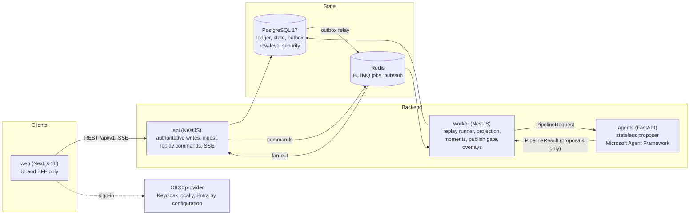
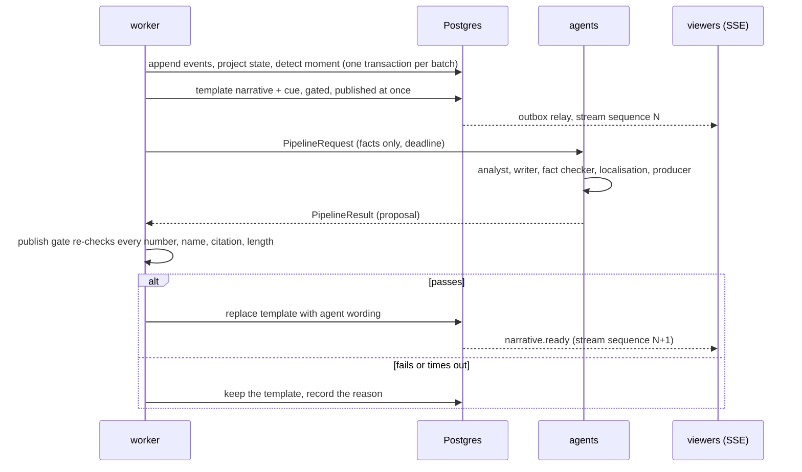

# Architecture overview

One page that explains how MatchIQ is built, why, and how it behaves when something fails. Every statement points to the decision record (ADR) or test that backs it. Evidence labels follow [SUBMISSION.md](../submission/SUBMISSION.md): **[VALIDATED]** measured or tested, **[DESIGN]** built but not exercised in the environment named, **[TARGET]** not measured.

## The idea in one paragraph

A deterministic engine is the only source of football facts. Everything a viewer reads is a template or a draft that cites those facts, and nothing airs until a deterministic gate re-checks it. Models are an optional, replaceable proposer: the product is complete with AI switched off, and a slow or wrong model can only lower quality, never publish a wrong number ([ADR-0002](../adr/0002-deterministic-engine-first.md), [ADR-0022](../adr/0022-independent-gate-guard-checks.md)).

## System context

| Component     | Owns                                                                                                                                        | Never does                                  |
| ------------- | ------------------------------------------------------------------------------------------------------------------------------------------- | ------------------------------------------- |
| `apps/web`    | Rendering, the same-origin BFF, accessibility                                                                                               | Talk to the database or a model             |
| `apps/api`    | Authoritative writes, ingest, permissions, tenant scoping, the SSE stream, the outbox relay                                                 | Call a model                                |
| `apps/worker` | The replay session runner, projection, key-moment detection, the **publish gate**, overlay scheduling                                       | Trust agent output without re-checking it   |
| `apps/agents` | Writing proposals for a moment, with its own independent fact checker                                                                       | Hold state, write to the ledger, publish    |
| `libs/*`      | `football-engine` and `narrative-guard` (pure), `contracts` (Zod source of truth), `db`, `auth`, `access`, `replay`, `config`, `server-kit` | Import a framework from a `type:domain` lib |

Module boundaries are enforced by Nx tags, not by convention ([ARCHITECTURE_RULES.md](../engineering/ARCHITECTURE_RULES.md)). `type:domain` libraries are pure and cannot import frameworks.

## The path of one key moment

1. **Ingest and replay.** Events enter an append-only ledger with `UNIQUE(org_id, fixture_id, sequence)` and `UNIQUE(org_id, fixture_id, event_id)`. A replay session is a new fixture plus a worker-owned runner ([ADR-0006](../adr/0006-persistence-and-messaging.md), [ADR-0013](../adr/0013-replay-sessions-and-intelligence-pipeline.md)).
2. **Deterministic projection.** Pure functions turn events into match state and a state hash. The same events give the same hashes and the same overlay decisions ([ADR-0008](../adr/0008-replay-determinism-scope.md)).
3. **Template first.** A verified template and a cue go on air immediately. This is why AI latency is never on the critical path.
4. **Agents propose.** A typed state machine (`DETECTED → ANALYZED → DRAFTED → VERIFIED`) with revise and reject branches, bounded retries and a hard deadline ([ADR-0011](../adr/0011-agent-orchestration.md)). The service returns a template-only result for any model failure, never an error.
5. **The gate decides.** The worker re-checks every cited value, numeral, evidence id, entity name and length with checks that share no code with the agents' fact checker ([ADR-0022](../adr/0022-independent-gate-guard-checks.md)).
6. **Editorial policy.** Freeze, suppress, retract, kill switch and approve-before-air apply after the scheduler, and every decision writes an audit row ([ADR-0016](../adr/0016-editorial-control-and-audit.md), [ADR-0024](../adr/0024-producer-approval-before-air.md)).

## Delivery and consistency guarantees

| Guarantee                                   | Mechanism                                                                                                                                                                  | Evidence                                                                               |
| ------------------------------------------- | -------------------------------------------------------------------------------------------------------------------------------------------------------------------------- | -------------------------------------------------------------------------------------- |
| Ledger is ordered and duplicate-free        | Unique `(org, fixture, sequence)` and `(org, fixture, event_id)`; a retried batch skips anything at or below the stored head                                               | ADR-0006, ADR-0013 · **[VALIDATED]**                                                   |
| Stream order and no gaps                    | `stream_messages` is both outbox and replay log; a per-fixture `stream_sequence` is allocated under the fixture row lock, so visible sequence N implies all lower ones     | ADR-0006 · **[VALIDATED]**                                                             |
| At-least-once delivery, exactly-once effect | The relay claims rows with `FOR UPDATE SKIP LOCKED` and marks them published in the same transaction; a crash republishes, and viewers deduplicate by `streamSequence`     | ADR-0006 · **[VALIDATED]**                                                             |
| Viewer resume                               | SSE `id` is the stream sequence; reconnect with `Last-Event-ID`, with a snapshot resync on a gap                                                                           | ADR-0005 · **[VALIDATED]**                                                             |
| Duplicate commands are harmless             | `Idempotency-Key` store; the key is claimed in its own transaction and the response stored only after the command is queued                                                | ADR-0015, ADR-0039 · **[VALIDATED]**                                                   |
| Capacity cannot get stuck                   | A slot is held only while `PLAYING` (or `IDLE` right after creation) within a freshness window; the API checks under an advisory lock and the worker rejects as a backstop | ADR-0015 · **[VALIDATED]**                                                             |
| Replays are reproducible                    | Same events give the same state hashes and overlay decisions                                                                                                               | ADR-0008 · **[VALIDATED]** (`pnpm perf:replay`: about 580 events/s on a loaded laptop) |

## What happens when something fails

| Failure                                         | What the viewer sees                   | What the system does                                                                                                                                          | Evidence                                                                                    |
| ----------------------------------------------- | -------------------------------------- | ------------------------------------------------------------------------------------------------------------------------------------------------------------- | ------------------------------------------------------------------------------------------- |
| Model slow or down                              | Standard wording, on time              | Per-call timeout inside a hard deadline, a timeout-specific circuit breaker (a slow model is busy, not down), and the reason is shown on the Fact-checks page | ADR-0011 · **[VALIDATED]** (demo scenario "Timed out", 27 Oct)                              |
| Model output fails the checks                   | Standard wording                       | No local retry (a retry costs a full generation and mostly repeats itself); each stage has a deterministic recovery                                           | ADR-0011 · **[VALIDATED]**                                                                  |
| Draft cites a number the engine never made      | The draft never airs                   | The agents' fact checker sends it back (revise) or the gate rejects it; the page says "Caught", with the plain reason                                         | ADR-0020, ADR-0022 · **[VALIDATED]** (scenarios "Wrong number fixed" and "blocked", 27 Oct) |
| Agents reply with an invalid response           | Standard wording                       | The worker validates the response against the shared contract, falls back, and logs the first five issues (path and code, never text)                         | MQ-119 · **[VALIDATED]** (found and fixed 27 Oct)                                           |
| Agents service unreachable                      | Standard wording                       | Liveness probe and per-call deadline; templates remain on air                                                                                                 | ADR-0011 · **[VALIDATED]** (CI with the model failing)                                      |
| Worker crashes mid-batch                        | Nothing is lost or doubled             | A batch is one transaction and the append skips what is already stored; on boot only `PLAYING` sessions resume, up to the capacity limit                      | ADR-0013, ADR-0015 · **[VALIDATED]**                                                        |
| Outbox relay crashes between publish and commit | A repeated message that viewers ignore | Rows are republished and deduplicated by `streamSequence`                                                                                                     | ADR-0006 · **[VALIDATED]**                                                                  |
| A viewer drops and returns                      | The stream continues where it stopped  | `Last-Event-ID` resume, or a snapshot if there is a gap                                                                                                       | ADR-0005 · **[VALIDATED]**                                                                  |
| A producer needs it off air                     | A banner, and nothing new airs         | Freeze, retract, suppress or the organisation kill switch, each permissioned, idempotent and audited                                                          | ADR-0016 · **[VALIDATED]**                                                                  |
| Cross-tenant access                             | The same "not found" as a missing item | Application scoping from the token plus Postgres row-level security as the second wall                                                                        | ADR-0018 · **[VALIDATED]** (cross-tenant suite)                                             |
| Redis unavailable                               | No new live updates                    | The ledger and outbox rows are in Postgres, so the stream catches up when Redis returns                                                                       | ADR-0006 · **[DESIGN]** not fault-injected                                                  |

## Security and tenancy

- **Identity.** The API is an OAuth 2.0 resource server: it verifies the JWT signature against the issuer's JWKS, plus issuer, audience and expiry. Claim names are configuration, so the same code accepts Keycloak and Microsoft Entra ID tokens ([ADR-0018](../adr/0018-identity-authorisation-and-tenant-isolation.md)). Only Keycloak has been exercised.
- **Authorisation.** Deny by default: every route declares exactly one permission or is explicitly public, and a test walks every controller to assert it. Six roles and one permission matrix are defined once in `libs/access` and shared by the API and the UI.
- **Tenancy.** The organisation comes only from the principal. Every tenant table has row-level security on `app.org_id`, and tenant work runs under a restricted role. Cross-tenant system work (migrations, seeding, the outbox relay) is confined to named `system*` call sites.
- **Untrusted text.** Event text reaches the model as escaped data blocks, and 13 scripted compromised-model attacks run in CI ([SUBMISSION.md](../submission/SUBMISSION.md#what-is-novel)).

## Contracts across languages

`libs/contracts` (Zod) is the single source of truth. It exports JSON Schema, and the Python agents' Pydantic models and the OpenAPI 3.1 document are generated from it ([ADR-0017](../adr/0017-openapi-from-zod-contracts.md)). CI fails on generated-code drift. The worker validates every agents response against the same schema.

A drift that generation alone cannot see appeared on 27 October: Python sent `breakdown: null` where the contract allows the field to be absent but not `null`, so the worker rejected every recorded moment. The fix drops empty optional fields on the wire, and a test now replays 19 real engine packets through the agents and validates each result with the worker's own schema (`apps/agents/tests/test_recorded_committed.py`).

## Observability

Structured JSON logs with request and correlation ids and redaction, OpenTelemetry traces with `traceparent` carried from the worker to the agents, and Prometheus metrics on an internal-only listener ([ADR-0019](../adr/0019-telemetry-baseline.md)). Telemetry is off unless configured, so the services behave the same without it. The Agent Observatory in the product shows every run, with provider, latency, the fact check and the gate result. The observability stack has been validated statically, not end to end.

## Testing

Pure-domain unit tests, API integration tests against real Postgres including the cross-tenant suite, contract tests across languages, a 46-case evaluation set with 13 scripted model attacks, end-to-end tests with axe accessibility checks, and a Compose smoke test ([TESTING_STRATEGY.md](../engineering/TESTING_STRATEGY.md)). The oracle used in the evaluation shares no code with the fact checker.

## Scaling: what changes at 10×

| Today                                     | The limit                                                                          | The path                                                                                                                      | Status       |
| ----------------------------------------- | ---------------------------------------------------------------------------------- | ----------------------------------------------------------------------------------------------------------------------------- | ------------ |
| One worker owns every replay session      | One replica ([ADR-0013](../adr/0013-replay-sessions-and-intelligence-pipeline.md)) | Shard sessions across replicas with a per-session lease; commands already travel by queue, so routing changes, not the domain | **[DESIGN]** |
| One agents call at a time per local model | Queueing: step times of 20 to 35 s were observed on 27 Oct                         | The agents service is stateless, so add replicas or a hosted model pool; expose queue depth and wait time per call            | **[TARGET]** |
| Redis for jobs and fan-out                | Single broker                                                                      | Queue and broker sit behind ports so a managed service bus can replace them without domain changes (ADR-0006)                 | **[DESIGN]** |
| Outbox relay runs in the API process      | One relay                                                                          | It is safe to run in several processes (`SKIP LOCKED`) and can move to the worker without a schema change                     | **[DESIGN]** |

## Known trade-offs and honest limits

- **Foundry and Entra ID were never exercised.** The provider and the claim mapping exist and are unit-tested; nothing has run against a real Azure subscription ([ADR-0003](../adr/0003-python-agents-service.md), [ADR-0012](../adr/0012-local-first-ai-providers.md)).
- **Queue wait is not yet visible.** A slow step looks like a slow model when part of it is waiting its turn. Exposing queue depth is the next observability change.
- **Expected 404s as control flow.** The trace lookup uses a 404 for "no handoffs recorded"; the web handles it, but the browser console logs it. Being addressed in MQ-122.
- **No load or soak test beyond the replay smoke**, and no fault-injection run for Redis loss.
- **Deferred by decision:** billing and metering, webhooks, SCIM and organisation self-service, privacy workflows, a hosted deployment ([ADR-0030](../adr/0030-usage-metering-and-billing.md) to [ADR-0036](../adr/0036-privacy-subject-access-and-deletion.md)).

## Decision index

| Theme               | ADRs                                                                                                                                                                                                                                                                                                          |
| ------------------- | ------------------------------------------------------------------------------------------------------------------------------------------------------------------------------------------------------------------------------------------------------------------------------------------------------------- |
| Foundations         | [0001](../adr/0001-nx-pnpm-monorepo.md) monorepo, [0002](../adr/0002-deterministic-engine-first.md) engine first, [0004](../adr/0004-event-taxonomy.md) event taxonomy, [0009](../adr/0009-test-runners.md) test runners                                                                                      |
| Data and messaging  | [0006](../adr/0006-persistence-and-messaging.md) persistence, [0005](../adr/0005-api-and-streaming-conventions.md) API and streaming, [0039](../adr/0039-ingest-validation-and-idempotency-key-policy.md) ingest and idempotency                                                                              |
| Replay and capacity | [0008](../adr/0008-replay-determinism-scope.md) determinism, [0013](../adr/0013-replay-sessions-and-intelligence-pipeline.md) sessions and pipeline, [0015](../adr/0015-replay-capacity-and-retention.md) capacity and retention                                                                              |
| Agents and AI       | [0003](../adr/0003-python-agents-service.md) service, [0011](../adr/0011-agent-orchestration.md) orchestration, [0012](../adr/0012-local-first-ai-providers.md) providers, [0022](../adr/0022-independent-gate-guard-checks.md) gate checks, [0042](../adr/0042-recorded-model-provider.md) recorded provider |
| Control and trust   | [0016](../adr/0016-editorial-control-and-audit.md) editorial control, [0018](../adr/0018-identity-authorisation-and-tenant-isolation.md) identity and tenancy, [0020](../adr/0020-demo-fault-scenarios.md) fault scenarios, [0024](../adr/0024-producer-approval-before-air.md) approve before air            |
| Platform and UX     | [0017](../adr/0017-openapi-from-zod-contracts.md) OpenAPI, [0019](../adr/0019-telemetry-baseline.md) telemetry, [0021](../adr/0021-accessible-component-foundation.md) accessible UI, [0043](../adr/0043-interface-and-commentary-language-preferences.md) languages                                          |
